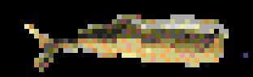

# tc002-apps

Apps for Ulanzi TC002 running AWTRIX NG, with Go services for processing data and publishing it to the clock from a VPS.

## Current status

This repository is a small toolkit with autonomous clock apps, weather and HTTP health integrations:

- `clockctl` sends notifications, deploys Berry scripts, and selects the displayed app over HTTP.
- `worker` demonstrates periodic execution and graceful shutdown; it does not process or publish data yet.
- `status-provider` checks an HTTP health endpoint and publishes to the `service-status` screen with explicit data expiry. See [setup and contract](docs/integrations/service-status.md).
- `weather-provider` fetches Open-Meteo current conditions and three-day forecasts for two separate screens. It can also print weather directly on the VPS. See [weather setup](docs/integrations/weather.md).
- `apps/clock/` contains on-device Berry apps, each with its own README.
- A local virtual clock is available for development without TC002 hardware.

Physical clocks must run **AWTRIX NG**. The stock Ulanzi firmware and AWTRIX 3 are not supported.

## Clock app previews

| Smoking Cigar | Swimming Mackerel | Kicking Seagull |
| --- | --- | --- |
|  |  |  |

Captured from the real headless AWTRIX engine. See [preview generation](docs/previews/README.md). The [service-status screen](docs/integrations/service-status.md) adds live HTTP health data with expiry.

## Project structure

```text
tc002-apps/
├── apps/
│   ├── README.md                  Which code runs where
│   ├── clock/                     ON THE TC002 — Berry scripts and assets
│   │   ├── README.md              Clock-app layout and installation
│   │   ├── screens/               Visual apps in normal rotation
│   │   ├── services/              Headless controllers and background providers
│   │   ├── on-demand/             Menu-started tools and games
│   │   └── assets/icons/          Shared clock icons (placeholder)
│   ├── server/                    ON A VPS — independent Go services
│   │   ├── README.md              Server-only responsibilities and builds
│   │   ├── cmd/worker/main.go     Periodic service entry point (placeholder)
│   │   └── Dockerfile             Server sources + shared libraries only
│   └── tools/                     ON A COMPUTER / ONE-OFF CONTAINER — utilities
│       ├── README.md              Utility layout and Docker usage
│       ├── cmd/clockctl/          Device-management and deployment CLI
│       ├── internal/
│       │   ├── build/             Go artifact selection and source discovery
│       │   ├── clockapps/         Berry catalog and metadata validation
│       │   ├── clockdeploy/       Confirmed phases and partial-deployment reports
│       │   └── clockcheck/        Execution/frame checking scenarios
│       └── Dockerfile             Tool sources + shared libraries only
├── internal/                      SHARED Go libraries
│   ├── awtrix/                    HTTP API client; no display-checking loops
│   └── config/                    TOML parsing/merging; no source discovery
├── configs/
│   ├── config.toml                Shared clock, build, and runtime settings
│   └── config.local.toml.example  Personal project config template
├── deploy/                        PRODUCTION — run Go services on your VPS
│   ├── compose.yaml               Services, images, and runtime settings
│   └── deploy.sh                  Deploy selected services or loaded images
├── dev/                           LOCAL — virtual clock for development
│   ├── compose.yaml               AWTRIX + Go tools, isolated from production
│   └── Dockerfile.awtrix          Build the pinned headless AWTRIX engine
├── scripts/                       Shell entry points used by Make
│   ├── select-apps.sh             Read Go build selection from project TOML
│   └── check-clock.sh             Run disposable local Berry runtime checks
├── docs/
│   ├── setup.md                   Connect to a physical TC002
│   ├── development.md             Virtual clock, commands, troubleshooting
│   ├── commands.md                Go flags and environment variables
│   ├── configuration.md           Unified TOML settings and personal overrides
│   ├── integrations.md            How screen/server components form one feature
│   ├── deployment.md              VPS deployment, image transfer, updates
│   └── architecture.md            Runtime boundaries and data flow
├── .github/workflows/ci.yml        Go/Docker builds and Berry runtime smoke checks
├── Makefile                       Main entry point for build and dev commands
├── go.mod                         Shared Go module for all Go code
├── .gitignore                     Keep local settings and build output out of Git
├── .dockerignore                  Keep local settings and output out of build context
├── CONTRIBUTING.md                How to add apps and submit changes
├── LICENSE                        MIT license for this repository
└── README.md                      Start here

Generated locally (not committed):
  bin/<group>/<app>               Native binaries (server or tools)
  dist/<group>/<app>.tar.gz       Exported images, separated by group
  configs/config.local.toml       Your clock, app selections, and runtime overrides
```

### Where to start

| I want to... | Start here | First step |
| --- | --- | --- |
| Try it without a clock | [Local development](docs/development.md) | After cloning, run `make dev-check` and open http://localhost:8080 |
| Send something to my TC002 | [Clock setup](docs/setup.md), [Go commands](docs/commands.md) | Set `AWTRIX_URL` and run `clockctl` |
| Write an app that runs on the clock | [Clock apps](apps/clock/README.md) | Choose a lifecycle and add `apps/clock/<kind>/<name>/main.be` |
| Process data on my VPS | [Server apps](apps/server/README.md) | Add `apps/server/cmd/<name>/main.go` |
| Show weather on the VPS and clock | [Weather integration](docs/integrations/weather.md) | Configure coordinates, run `weather-provider --print`, then deploy the two screens |
| Manage clocks or development workflows | [Utility apps](apps/tools/README.md) | Use `clockctl` or the Make commands |
| Build and deploy only selected Go apps | [VPS deployment](docs/deployment.md) | Set `server.apps`, then run `make docker-save GROUP=server` |
| Plan a screen/VPS integration (alpha) | [Integration design](docs/integrations.md) | Explore the ID/contract convention; automatic pairing is not implemented |
| Contribute a change | [Contributing](CONTRIBUTING.md) | Follow the app layout and run the relevant checks |

### How the pieces connect

```text
VPS / computer                            TC002 running AWTRIX NG
┌────────────────────────┐                ┌──────────────────────────────┐
│ apps/server/ (Go)       │   HTTP / MQTT  │ Built-in screens / alerts    │
│ Fetch and process data ├───────────────>│ or apps/clock/ (Berry)       │
└────────────────────────┘                │ Custom on-device rendering   │
                                          └──────────────────────────────┘

Local development: dev/ runs headless AWTRIX in Docker instead of a TC002.
Production: deploy/ runs Go services on the VPS; Berry stays on the clock.
Management: apps/tools/ handles deployment, notifications, and local checks.
HTTP notifications and on-device Berry apps work today; MQTT integration is planned.
```

## Quick start

### Requirements

- Git to clone the repository.
- Make and a POSIX shell for the Make commands (Linux, macOS, or WSL).
- Go 1.24+ for native builds and checks.
- Docker with Compose v2 for containers; local development uses `up --wait`.
- `gzip` for `make docker-save`.

Go is not required on the host for Docker-only workflows. An internet connection is needed for the initial image builds and dependency downloads.

Clone the repository first:

```sh
git clone https://github.com/LikiPiki/tc002-apps.git
cd tc002-apps
```

### Native Go

For standalone notifications and diagnostics, download the `clockctl` archive for your OS/architecture from [GitHub Releases](https://github.com/LikiPiki/tc002-apps/releases), verify it against `SHA256SUMS`, extract it, and run `clockctl --version`. Releases cover Linux, macOS and Windows on amd64/arm64. Berry source deployment still needs a checkout or an explicit app catalog. See [release builds](docs/releases.md).

```sh
make check
make build
go run ./apps/server/cmd/worker --once
# Replace the address with your clock's reachable IP or hostname.
AWTRIX_URL=http://192.168.1.50 go run ./apps/tools/cmd/clockctl --text 'Hello from Go'
```

The notification command needs a reachable AWTRIX NG instance without API authentication. See [clock setup](docs/setup.md) and the [command reference](docs/commands.md) for flags and environment variables.

### Select what to build

All settings use `configs/config.toml` and optional `configs/config.local.toml` overrides. Start with `cp configs/config.local.toml.example configs/config.local.toml`. `[server] apps` selects VPS commands; `[tools] apps` selects utility commands. Under `[clock.deploy]`, select `screens`, `services`, and `on_demand` independently. See [Project configuration](docs/configuration.md).

```sh
make list-apps
make build
make docker-build
make docker-build GROUP=server # Only VPS images
make build GROUP=tools         # Only utility binaries
```

`GROUP=all` is the default for Go build/export commands. Artifacts have qualified names such as `server/worker` and `tools/clockctl`. Run `make docker-save GROUP=server` to export VPS images to `dist/server/<app>.tar.gz`. See [deployment](docs/deployment.md) and [utility apps](apps/tools/README.md).

This selection applies to `make build`, `make docker-build`, and `make docker-save`. It does not control which Compose services are started.

### Deploy Berry apps to the clock

```sh
cp configs/config.local.toml.example configs/config.local.toml
# Set [clock] url in configs/config.local.toml.
make clock-list
make clock-deploy          # Apps selected by category in TOML
make clock-deploy KIND=services
make clock-show APP=<name>
make clock-start APP=<tool> # Start an installed on-demand app
make clock-stop APP=<tool>  # End its session
```

Use `make clock-deploy APP=<name>` to update one app by its unique install name. Each app has `main.be` and a README under its lifecycle directory. Settings live in `clock.screens.<name>`, `clock.services.<name>`, or `clock.on_demand.<name>`. Shared TOML defaults to the local virtual clock; personal overrides are excluded from Git. To use shared defaults alone, pass `LOCAL_CONFIG=` and keep `AWTRIX_URL` unset. See [Berry deployment](docs/commands.md#berry-deployment) for error checks.

## Docker

```sh
# Configure configs/config.local.toml before sending to a physical clock.
sh deploy/deploy.sh worker
docker compose -f deploy/compose.yaml logs -f worker
```

Containers read the same TOML files through a read-only mount; no `.env` file is needed. The worker is a placeholder and logs a tick at `server.worker.interval`. Stop it with `docker compose -f deploy/compose.yaml down`. See [VPS deployment](docs/deployment.md) for image-only deployment and platform selection.

## Local testing without a clock

```sh
make dev-check
# Open http://localhost:8080 for a virtual TC002 with a 52 x 16 display.
make dev-notify TEXT="Hello TC002"
# When finished:
make dev-down
```

The development environment builds the actual headless AWTRIX NG engine in an Alpine container. See the [local development guide](docs/development.md) for details and limitations. Run `make help` to list the main commands.

For an automatic runtime smoke check, run `make clock-check` (or select one app with `APP=<name>`). It builds a disposable local AWTRIX, executes each app for a short observation window, and checks runtime errors and pixel frames. It does not use the physical-clock target or modify the regular dev instance. See [runtime checks](docs/development.md#runtime-checks).

Further reading: [VPS deployment](docs/deployment.md), [clock setup](docs/setup.md), and [architecture](docs/architecture.md).

## Contributing

New apps, integrations, fixes, and documentation improvements are welcome. See [CONTRIBUTING.md](CONTRIBUTING.md) for the app layout, checks, and pull request workflow. Keep documentation, code comments, and examples in English.

## License

The code in this repository is [MIT licensed](LICENSE). AWTRIX NG is a separate dependency with its own [PolyForm Noncommercial license](https://github.com/Blueforcer/awtrix-ng/blob/main/LICENSE.md); the local development image builds and includes that project.
